# Payment Service

A backend payment processing service supporting multiple gateways (Stripe, Razorpay, PayU), written in Go using a hexagonal (ports-and-adapters) architecture. It handles payment creation and settlement, refunds, cancellations, inbound gateway webhooks, and the reliability infrastructure (outbox, idempotency, circuit breakers, lease recovery) needed to run payments safely at scale.

This document describes the architecture, the core domain logic, and the operational processes underneath, with diagrams for each major flow.

---

## Table of Contents

- [1. Overview](#1-overview)
- [2. Architecture](#2-architecture)
- [3. Project Layout](#3-project-layout)
- [4. Core Domain: The Transaction Lifecycle](#4-core-domain-the-transaction-lifecycle)
- [5. Creating and Processing a Payment](#5-creating-and-processing-a-payment)
- [6. Gateway Routing](#6-gateway-routing)
- [7. Gateway Fallback and Retry Semantics](#7-gateway-fallback-and-retry-semantics)
- [8. Circuit Breaker](#8-circuit-breaker)
- [9. Idempotency](#9-idempotency)
- [10. Transactional Outbox and Relay](#10-transactional-outbox-and-relay)
- [11. Inbound Webhooks](#11-inbound-webhooks)
- [12. Refunds and Cancellation](#12-refunds-and-cancellation)
- [13. Lease-Expiry Reaper](#13-lease-expiry-reaper)
- [14. Partition Management](#14-partition-management)
- [15. Rate Limiting](#15-rate-limiting)
- [16. Authentication and Authorization](#16-authentication-and-authorization)
- [17. Transport Security (mTLS)](#17-transport-security-mtls)
- [18. Field-Level Encryption](#18-field-level-encryption)
- [19. Observability](#19-observability)
- [20. API Reference](#20-api-reference)
- [21. Configuration](#21-configuration)
- [22. Running Locally](#22-running-locally)
- [23. Testing](#23-testing)
- [24. Continuous Integration](#24-continuous-integration)

---

## 1. Overview

The service is split into three deployable binaries that share the same domain and adapter code:

| Binary | Path | Responsibility |
|---|---|---|
| **api** | `cmd/api` | HTTP server: create/process payments, refunds, cancellations, receive gateway webhooks, health checks |
| **relay** | `cmd/relay` | Polls the transactional outbox and publishes domain events downstream |
| **jobs** | `cmd/jobs` | One-shot scheduled jobs: `partition_manager` (outbox table partitioning) and `lease_expiry` (stuck-transaction recovery + idempotency-key cleanup) |

Supported payment gateways: **Stripe**, **Razorpay**, **PayU** (`internal/adapters/gateways/*`), each behind a common `ports.GatewayAdapter` interface so the core payment/refund logic is gateway-agnostic.

Supported payment methods: card, UPI, netbanking, wallet (varies by gateway capability).

Key reliability properties the service is built around:

- **No lost writes**: every state change that must also emit an event does so inside one DB transaction via the **transactional outbox** pattern.
- **No duplicate side effects**: idempotency is enforced in the business layer (`idempotency.Guard`, reserve and operation in one database transaction), plus a DB-level advisory lock on the parent transaction for refund sums.
- **No double-charging on ambiguous gateway failures**: the fallback logic distinguishes "definitely declined" (safe to retry elsewhere) from "unknown, maybe charged" (never retried automatically).
- **Self-healing on stuck payments**: a background reaper reconciles any transaction whose processing lease expired without a resolution.

---

## 2. Architecture

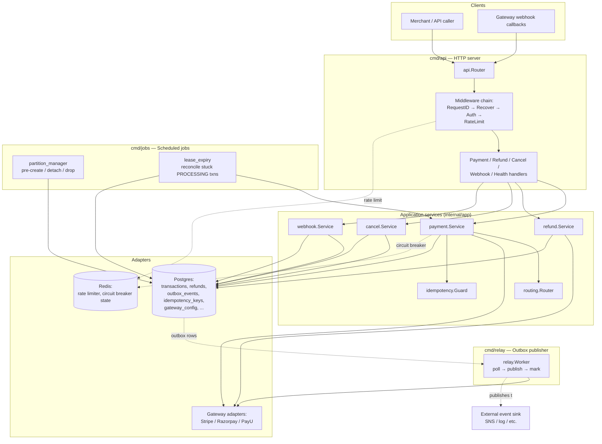

The design follows **hexagonal architecture**:

- `internal/domain/` — pure business rules with no I/O: the transaction state machine, refund invariants (over-refund protection), routing scoring, circuit breaker state machine, reconciliation eligibility rules.
- `internal/app/` — use-case orchestration: takes domain objects and ports (interfaces), coordinates transactions, calls gateways, writes outbox events.
- `internal/ports/` — interfaces the app layer depends on (`GatewayAdapter`, `Logger`, `MetricRecorder`, `OutboxWriter`, `ConfigStore`, …), so the app layer never imports a concrete adapter.
- `internal/adapters/` — concrete implementations: Postgres repositories, Redis rate limiter/circuit-breaker store, gateway HTTP clients, TLS manager, envelope encryption, slog-based logger.
- `internal/api/` — HTTP-specific concerns: routing, middleware, request/response DTOs.

---

## 3. Project Layout

```
cmd/
  api/            HTTP server entrypoint
  jobs/            partition_manager & lease_expiry job entrypoint
  relay/           outbox relay worker entrypoint
config/            environment-variable driven configuration + validation
internal/
  domain/
    transaction/   Transaction entity + state machine
    refund/        Refund entity + over-refund guard
    routing/       Gateway scoring/selection algorithm
    gateway/       Circuit breaker state machine, discrepancy metrics
    reconciliation/ Settlement mismatch types + auto-resolution eligibility
  app/
    payment/       CreatePayment, ProcessPayment, RecoverExpiredLease
    refund/        InitiateRefund, ProcessRefund, ResolveCancelRefund
    cancel/        Cancel intent handling
    webhook/       Inbound webhook → transaction resolution
    routing/       Router orchestration around domain/routing
    idempotency/   Reserve/Lookup/Complete guard used by payment & refund
  adapters/
    postgres/      Repositories, migrations-backed queries, Transactor
    redis/         Rate limiter (token bucket, Lua), circuit breaker store
    gateways/      stripe/, razorpay/, payu/ adapters + webhook parsers
    security/      mTLS certificate manager
    encryption/    Envelope encryption (KMS-style key manager)
    observability/ slog logger with field redaction, no-op metrics
  api/
    handlers/      HTTP handlers (payment, refund, cancel, webhook, health)
    middleware/    Auth, RateLimit, ClientIP, RequestID, Recover
  server/          Listener lifecycle: bind, serve, drain, concurrent shutdown
  jobs/
    partition_manager/  Weekly outbox partition lifecycle
    lease_expiry/       Stuck-transaction reaper + idempotency-key sweep
  relay/           Generic outbox polling worker + publisher interface
  ports/           All interfaces + shared types (GatewayAdapter, Logger, ...)
  testsupport/     Shared Postgres/Redis test harness
test/
  integration/     Integration tests against real Postgres/Redis (integration build tag)
  e2e/             Reserved for end-to-end tests of the running binary (empty)
  unit/            Black-box unit tests, mirroring the source tree
  performance/     Latency and allocation budgets (performance build tag)
migrations/        Numbered up/down SQL migrations
deploy/docker/     docker-compose stack for local Postgres + Redis
Dockerfile         Multi-stage build for all three binaries (SERVICE build arg)
.github/workflows/ CI pipeline
```

---

## 4. Core Domain: The Transaction Lifecycle

Every payment is represented by a `Transaction` with a strictly enforced state machine (`internal/domain/transaction/state_machine.go`). Invalid transitions return `ErrInvalidTransition` rather than silently mutating state, and transitions out of `PROCESSING` clear the processing lease fields.

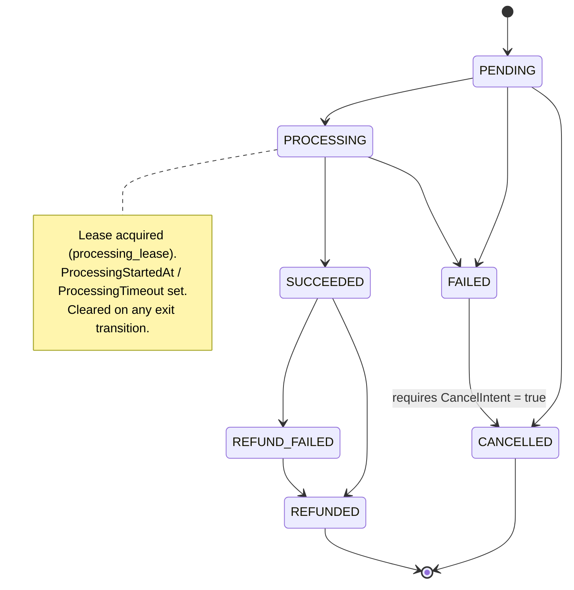

Notable rules baked into `transaction.go` / `state_machine.go`:

- `PENDING`, `PROCESSING`, `SUCCEEDED`, `FAILED`, `CANCELLED`, `REFUNDED`, `REFUND_FAILED` are the only statuses (`AllStatuses()`).
- `IsTerminal()` is true for `SUCCEEDED`, `CANCELLED`, `REFUNDED`, `REFUND_FAILED` — note that `SUCCEEDED` is terminal for the *payment* even though a refund can still be attached afterward.
- A transaction carries `Version` for **optimistic locking**: `UpdateStatus` fails with `ErrVersionConflict` if the stored version doesn't match, and `ErrNotFound` (a distinct case) if the row simply doesn't exist.
- `AttemptedGateway` vs `ActualGateway` are tracked separately so a fallback to a different gateway is visible (`HasGatewayDiscrepancy()`).

---

## 5. Creating and Processing a Payment

`POST /payments` is handled synchronously end-to-end in the current implementation: create, then immediately attempt processing. If processing fails transiently, the client still gets back a `202 Accepted` with the `PENDING`/`PROCESSING` transaction, and the lease-expiry reaper (§13) will pick it up later if it gets stuck.

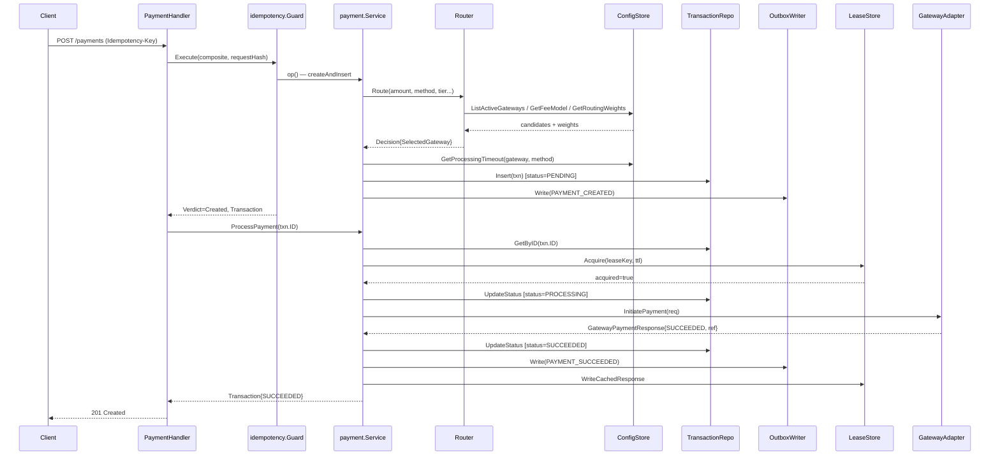

Key implementation details:

- **`Idempotency-Key` is mandatory** on `POST /payments`, `POST /payments/{id}/refunds` and `POST /payments/{id}/cancel`. It's combined with a scope (the merchant ID, or the transaction ID for cancel) and the operation into a composite hash (`idempotency.Composite`), and the request body is hashed (`idempotency.RequestHash`) to detect key reuse with a different payload (→ `409 idempotency_key_reused`).
- **The processing lease** (`processing_lease` table, `LeaseStore.Acquire`) prevents two concurrent `ProcessPayment` calls (e.g., a client retry racing the reaper) from both calling the gateway. If the lease isn't acquired, the current (possibly still-`PENDING`) transaction is returned untouched.
- **`EstimatedTimeoutSeconds`** comes from `ConfigStore.GetProcessingTimeout(gateway, method)` and becomes the lease TTL — it must be positive or transaction creation fails.
- If `ProcessPayment` errors after a successful `CreatePayment` (e.g. gateway adapter unavailable), the handler returns **`202 Accepted`** with the created-but-unprocessed transaction rather than failing the whole request.

---

## 6. Gateway Routing

`internal/domain/routing` implements a weighted-scoring gateway selection algorithm, orchestrated by `internal/app/routing.Router`.

Filtering (candidates are dropped before scoring, `filterReason`):
- Inactive gateway
- Amount outside `[MinAmount, MaxAmount]`
- Currency not supported
- Live circuit breaker `OPEN` and still within cooldown
- 24h discrepancy rate > 20%

The request-independent checks (inactive, breaker, discrepancy) live in `UnavailableReason`,
which `filterReason` calls after the amount and currency checks. `Router.Availability` applies
that same function, with the same live breaker lookup, to answer "is this gateway routable
right now" for `/health-gateways` (§20), so the health view cannot disagree with routing.

Scoring (each candidate gets a 0–100 sub-score per dimension, combined via configurable `Weights` that must sum to 1.0, ±0.001 tolerance, with at most 2 zero-weighted dimensions):

| Dimension | Signal |
|---|---|
| Volume | Relative to the highest 7-day volume among candidates |
| Cost | Relative to the highest calculated fee among candidates (cheaper = higher score) |
| Reliability | `1 - discrepancyRate24h`, or the last known score if the breaker is `OPEN` |
| FX efficiency | Always 100 for domestic currency; otherwise the pre-computed FX ratio |
| Latency | Based on p99 latency vs. the configured SLA |

Ties within 1 point (100 in the ×100-scaled integer score) are broken first by **fewer active payment intents**, then **lexicographically by gateway ID** — deterministic and reproducible.

The router also checks the **live** circuit-breaker state from Redis (via `BreakerStateReader`), not just the config snapshot, and treats an `OPEN` breaker whose cooldown has elapsed as `HALF_OPEN` (a legal routing target — enabling the probe described in §8), falling back to the config snapshot if Redis is unavailable ("fail open to config").

---

## 7. Gateway Fallback and Retry Semantics

This is the part of the payment flow most sensitive to correctness: **not all gateway failures are safe to retry on a different gateway.** `internal/app/payment/process.go`'s `attemptGateways` encodes this explicitly by error category.

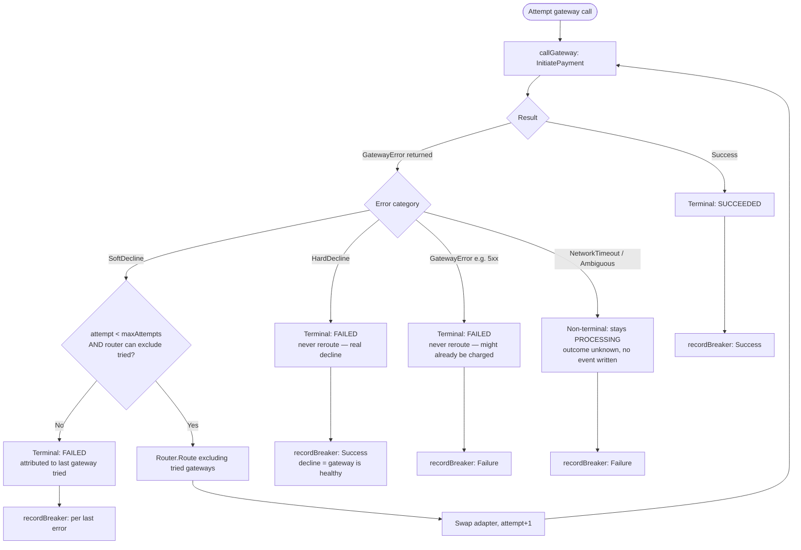

Why each category behaves the way it does:

- **`HardDecline`** (e.g. `card_declined`, `expired_card`): the card/account was genuinely rejected. Retrying on a *different* gateway wouldn't change the outcome and can look like fraud probing, so it's terminal `FAILED` immediately. It also counts as a **breaker success**, because a decline proves the gateway itself is healthy and responsive.
- **`SoftDecline`** (e.g. `insufficient_funds`, `try_again_later`): plausibly transient or issuer-side, and *not* an indication the gateway already captured funds — safe to retry elsewhere, bounded by `SetMaxGatewayAttempts(n)` (default 1 attempt, i.e. no fallback unless explicitly configured).
- **`NetworkTimeout` / `Ambiguous`**: the request may or may not have reached the gateway, or a response may have been lost in transit. The transaction is deliberately left **non-terminal** (`PROCESSING`) rather than guessed at — no outbox event is written, and it's the lease-expiry reaper's job (§13) to later call `CheckStatus` and resolve it definitively.
- **`GatewayError`** (5xx / unexpected gateway failures): treated the same as ambiguous for *fallback* purposes — it is **never** retried on a different gateway, because the first gateway might have accepted and processed the charge despite returning an error. It does finalize as `FAILED` here specifically for the synchronous attempt path (distinct from the reaper's more conservative "leave it alone" handling of the same category during recovery).
- **Circuit breaker recording**: `NetworkTimeout`, `GatewayError`, and `Ambiguous` all count as **breaker failures** (they indicate gateway-side health problems); `HardDecline` and `SoftDecline` do not.

The fallback loop tracks every gateway ID already tried (`tried []string`) and passes it to the router as `ExcludeGateways`, so a second attempt can never retry the same gateway that just failed.

---

## 8. Circuit Breaker

`internal/domain/gateway` defines the state machine; `internal/adapters/redis.CircuitBreakerStore` persists it atomically via Lua scripts (`RecordFailure`, `RecordSuccess`, `Transition`) so concurrent API instances agree on state without races.

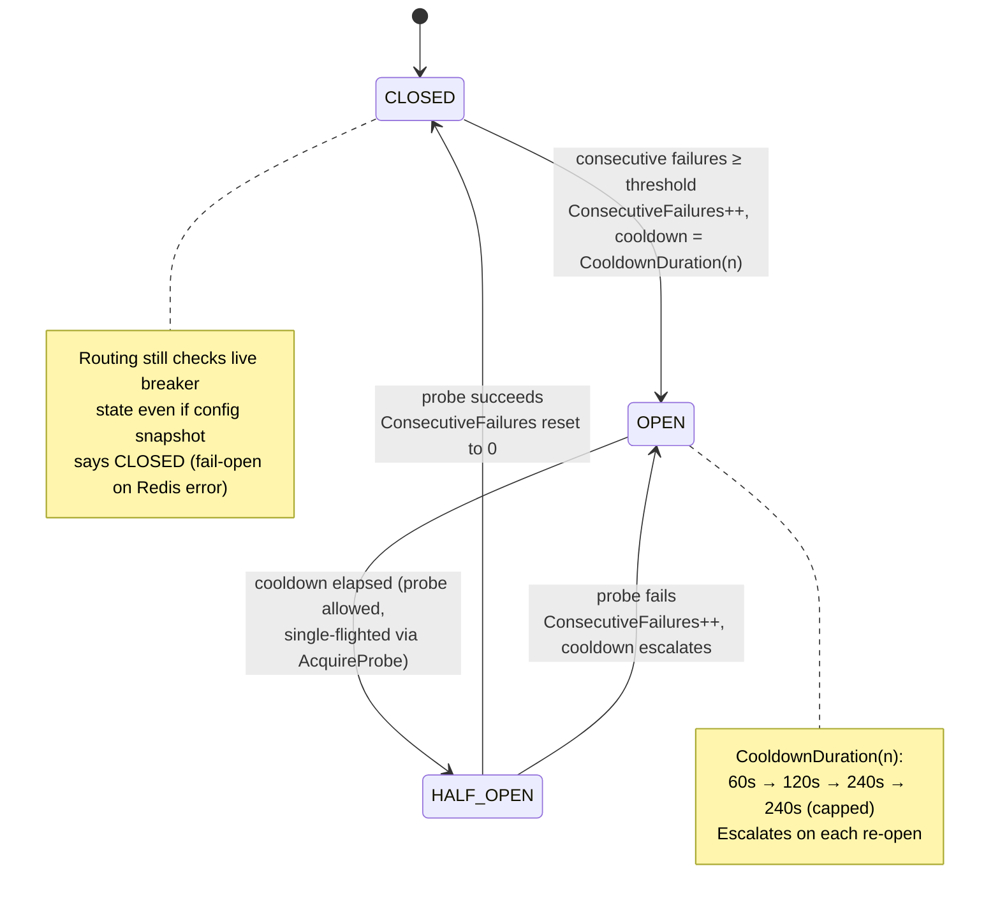

- **Cooldown escalation**: `CooldownDuration(n)` doubles per consecutive failure (60s, 120s, 240s), capped at 240s, so a gateway that keeps failing right after being re-enabled gets progressively longer timeouts instead of hammering it every 60 seconds.
- **Single-flighted probing**: `AcquireProbe` uses a Redis `SETNX` so that when a breaker's cooldown has elapsed, only one in-flight request is allowed to "probe" the gateway (routed as if `HALF_OPEN`) while others still treat it as unavailable — avoiding a thundering herd hitting a gateway the moment its cooldown lapses.
- **Fail-open on Redis outage**: if the breaker store itself is unreachable, `Router.liveBreakerState` falls back to the last-known state from the config snapshot rather than blocking all routing decisions on Redis being up.
- Only `CLOSED → OPEN`, `OPEN → HALF_OPEN`, and `HALF_OPEN → {CLOSED, OPEN}` are legal; anything else (e.g. `CLOSED → HALF_OPEN` directly) is rejected by the transition script.

---

## 9. Idempotency

Idempotency is enforced in **one place**, the business layer: `app/idempotency.Guard`, used by `payment.Service.CreatePayment`, `refund.Service.InitiateRefund` and `cancel.Service.Cancel` to guard the domain operation itself (insert + outbox write), independent of how it is invoked. There is no HTTP response cache in front of it: on a replay, payment, refund and cancel all reload the current state from Postgres rather than returning a stored snapshot, so a retried payment that has since settled reports `SUCCEEDED`, not the `PENDING` it got the first time. (Cancel replays the original *outcome*, `CANCEL_REQUESTED` or `ALREADY_TERMINAL`, with the *current* status.)

Composite keys are scoped per operation: create-payment by the merchant, initiate-refund by the parent transaction's merchant, cancel by the transaction ID. For a service token the merchant is always the token's own: create takes it from the token (a different `merchant_id` in the body is `403 merchant_mismatch`), and refund and cancel check the transaction's owner **before** the key is reserved, so a foreign transaction is a `404` that leaves no key, refund or intent behind. Ops tokens act across merchants. See §16 for the authorization rules and `test/integration/merchant_isolation_test.go` for the end-to-end tests.

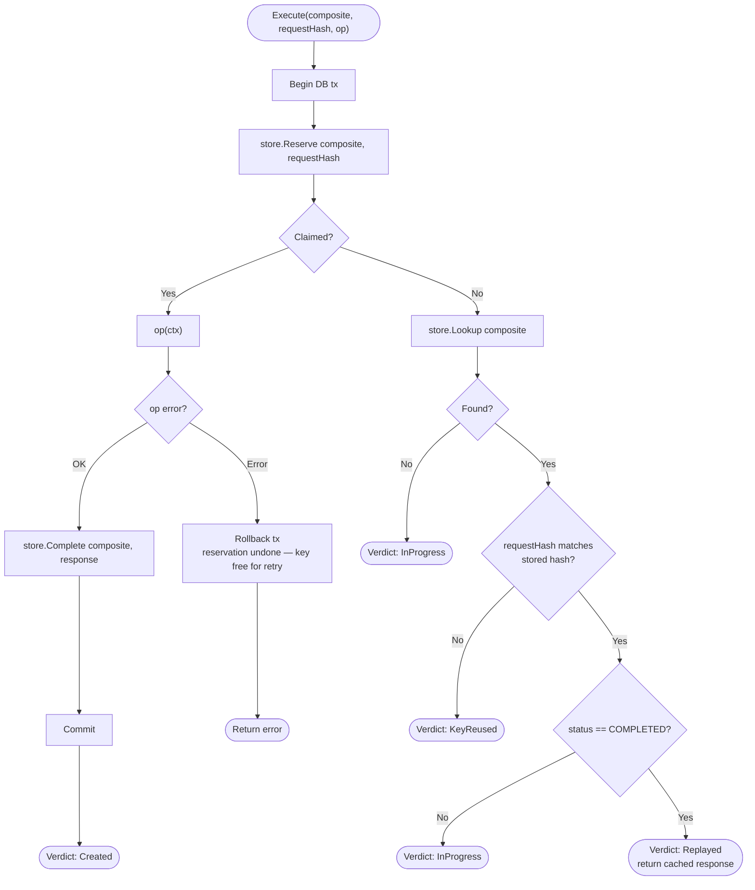

Four possible verdicts, mapped to distinct HTTP outcomes by the handlers:

| Verdict | Meaning | HTTP response |
|---|---|---|
| `Created` | First time seeing this key; op ran | `201 Created` |
| `Replayed` | Op already completed; the stored result (for example the created transaction ID) is used to reload current state | `200 OK` with the current resource |
| `InProgress` | Another request with this key is still running | `409 idempotency_in_progress` |
| `KeyReused` | Same key, different request body | `409 idempotency_key_reused` |

A failed op **rolls back the reservation** (the whole guard runs inside `Transactor.WithinTx`), so a request that errors midway doesn't permanently strand the key — a retry can claim it fresh.

---

## 10. Transactional Outbox and Relay

Every state change that needs to notify the outside world writes an `outbox_events` row **inside the same database transaction** as the state change itself (`OutboxWriter.Write` requires an ambient tx via `WithTx`). This guarantees the event is never lost (it's part of the same atomic commit) and never emitted for a change that didn't actually persist (it's rolled back together).

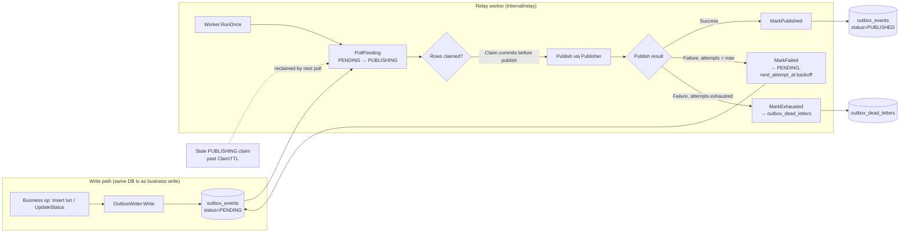

Design points that matter operationally:

- **Claim-before-publish, not select-then-publish**: `PollPending` atomically transitions matched rows `PENDING → PUBLISHING` (or reclaims stale `PUBLISHING` rows past `ClaimTTL`, default 60s) and *commits that claim* before the caller ever calls `Publish`. An earlier design that used `SELECT ... FOR UPDATE SKIP LOCKED` without committing the claim first would let two relay workers both fetch and publish the same event, since the row lock released at commit time — after publishing, not before.
- **Backoff on failure**: a failed publish sets `next_attempt_at` using exponential backoff (`Worker.backoff`, base × 2^attempts, capped at `MaxBackoff`) and returns the event to `PENDING` for retry, up to `MaxAttempts` (default 5).
- **Dead-lettering**: once attempts are exhausted, `MarkExhausted` moves the event to `outbox_dead_letters` in the same transaction it removes/marks the original — replayable later via `ReplayDeadLetter`, which re-enqueues a **new** event ID rather than resurrecting the old one.
- **Shard-aware polling**: `PollPending(shardMin, shardMax, ...)` lets multiple relay workers split the keyspace so they don't compete for the same rows, without needing external partitioning of workers.
- **Weekly partitioning**: `outbox_events` itself is a partitioned table (see §14) so old, fully-published partitions can be detached and dropped instead of bloating one ever-growing table.

---

## 11. Inbound Webhooks

`POST /webhooks/gateway/{gateway_id}` receives asynchronous status updates from gateways and reconciles them against the internal transaction record.

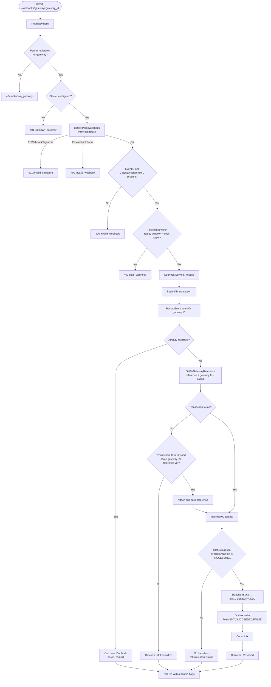

Security and correctness details:

- **Per-gateway signature verification** is delegated to each adapter's `ParseWebhook` (`GatewayWebhookParser`): Stripe verifies an HMAC-SHA256 over `timestamp.body` and rejects payloads outside a 300-second tolerance window; Razorpay verifies an HMAC-SHA256 header signature; PayU verifies its SHA-512 "reverse hash" over form fields (including the optional `additionalCharges` field, which changes the digest if present).
- **Duplicate delivery is a no-op, not an error**: gateways commonly redeliver webhooks; `RecordEvent` uses a unique constraint on `(event_id, gateway_id)` so a redelivery is detected and short-circuited before any transaction mutation, still returning `200 OK`.
- **Only `PROCESSING` transactions are mutated**, and only for a status that maps to a terminal outcome (`succeeded/success/captured/paid` → `SUCCEEDED`; `failed/failure` → `FAILED`). A webhook arriving for an already-terminal or non-`PROCESSING` transaction is accepted but causes no transition — this prevents a stale or out-of-order webhook from clobbering a status that a different code path (e.g. the reaper) already resolved.
- **Matching uses the gateway last called.** The lookup compares against `actual_gateway` (falling back to the originally routed `gateway_id`), so after a fallback from Stripe to Razorpay, Razorpay's webhook finds the payment. It used to compare against `gateway_id`, which is never updated, so such webhooks were reported as unknown.
- **Fallback match by transaction ID.** When no row has the reference (the process died before saving it), the payload's transaction ID is used: Stripe's `metadata.transaction_id`, or Razorpay's order or payment `notes.transaction_id`. It only matches a transaction routed to the same gateway that has no reference yet, so a webhook cannot be attached to another gateway's payment or overwrite a reference. The payload is signature-verified first, and the ID is one we set when creating the payment.
- **Timestamp/replay-window check** (`checkTimestamp`) is optional per gateway (`ConfigStore.WebhookPolicy`) and only enforced if the gateway sends an `X-Webhook-Timestamp` header.

---

## 12. Refunds and Cancellation

### Refund invariants

`domain/refund.New` refuses to construct a refund that would push `alreadyRefunded + amount` past the original transaction amount, returning a typed `ErrOverRefund` — checked against a `SELECT ... FOR UPDATE`-style lock on the parent transaction (`LockParentTransaction`) so concurrent refund requests can't race past the cap.

Refund gateway outcomes follow the same "don't guess on ambiguity" principle as payments: a `GatewayError`/`NetworkTimeout`/`Ambiguous` response leaves the refund in `REFUND_PROCESSING` rather than declaring `REFUND_FAILED` (which would invite an unsafe retry that could double-refund).

### Cancel-intent race with a still-succeeding payment

The most interesting correctness case in the service: a merchant/ops cancel request can land *while a payment is still in flight at the gateway*. If the gateway ends up honoring the payment anyway, the service must notice and auto-refund exactly once.

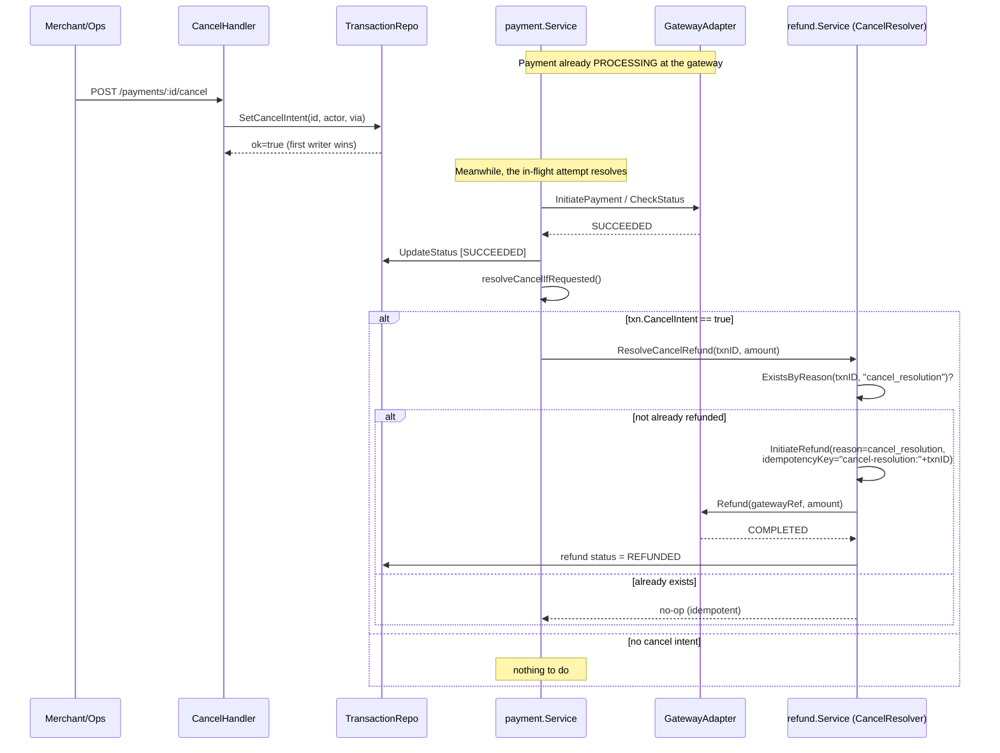

Why this is safe under concurrency:

- **`SetCancelIntent`** is a single conditional `UPDATE` — only the first caller for a given transaction wins (`TestCancel_ConcurrentSingleIntent` proves exactly one winner under 16 concurrent callers), and it's a no-op on already-terminal transactions (`CancelService.Cancel` returns `ALREADY_TERMINAL` without writing).
- **`ResolveCancelRefund` is doubly idempotent**: it checks `ExistsByReason(txnID, "cancel_resolution")` before initiating anything, *and* the refund itself is initiated with a deterministic idempotency key (`"cancel-resolution:" + txnID`), so even if the finalize path somehow ran twice (e.g. reaper + synchronous path both resolving the same lease), only one `cancel_resolution` refund is ever created.
- **`FAILED → CANCELLED` still requires `CancelIntent`** at the state-machine level (§4) — cancellation is never implicit, it's always driven by an explicit recorded intent.

---

## 13. Lease-Expiry Reaper

A payment that got stuck `PROCESSING` — because the synchronous attempt hit a `NetworkTimeout`/`Ambiguous`/`GatewayError` and correctly declined to guess — needs something to eventually resolve it. That's the `lease_expiry` job (`cmd/jobs JOB=lease_expiry`), intended to run on a schedule (e.g. every minute).

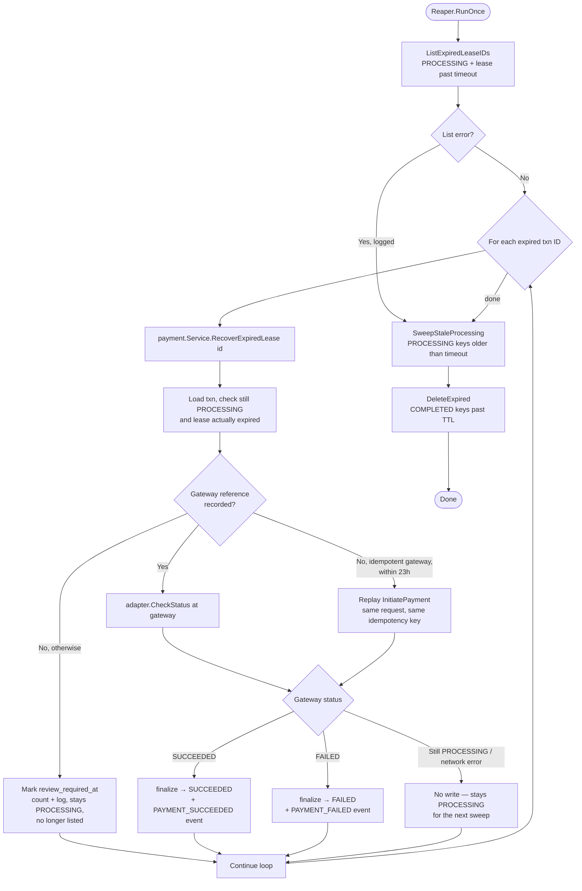

- **Status check when the reference is known**: `RecoverExpiredLease` calls `CheckStatus`, a read-only query by the gateway reference, so it only finds out what already happened and records it.
- **The reference is saved as soon as the gateway answers**, in its own write right after `InitiatePayment` returns, before fallback or `finalize`. An interruption after that point leaves a row the reaper can status-check, so the cases below only arise when the process dies during the gateway call itself or between the answer and that write.
- **Idempotent replay when it is not**: if the process died before the reference was saved (deploy, crash, OOM), there is nothing to look up. A status check by an empty reference returns a request error, which used to finalize the payment as `FAILED` even if the card had been charged. The reaper now re-sends the original `InitiatePayment` request instead, **only to gateways whose adapter declares `IdempotencyCapable`**. Adapters derive their idempotency key from the transaction ID and attempt number, so the request carries the same key: Stripe returns the stored result of the first call rather than charging again, and PayU's initiate is a local, deterministic transaction ID. Razorpay declares itself not idempotent (its key is only an order `receipt` label, not enforced as unique), so a replay would create a second order; it is never replayed. After a replay only a definite status or a replayed decline is final; any other error, such as an idempotency conflict while the original call is still in flight, leaves the transaction `PROCESSING` for the next sweep. A replayed soft decline is final too: the live path would have fallen back to another gateway with the customer present, but opening a new charge from a background job hours later is a policy decision, not recovery, so the payment is `FAILED` with reason `soft_decline` and the merchant can retry.
- **Manual review is a recorded state, not a log line**: with no reference and a non-idempotent gateway, or past 23 hours (Stripe keeps idempotency keys for 24), nothing is sent. The row is marked with `review_required_at` and `review_reason` (`gateway_not_idempotent` or `replay_window_passed`), counted once in `transaction.review_required` (tagged with gateway and reason, for alerting), logged as `recovery_requires_manual_review`, and dropped from the expired-lease listing so the reaper stops re-processing it. The status stays `PROCESSING`, which is true: the outcome is unknown until someone checks the gateway dashboard. `GET /payments/{id}` returns `"review_required": true` so the merchant can see why it is not moving.
- **Review rows get resolved, two ways**:
  - **A late webhook settles it.** Webhooks match by gateway reference, and fall back to our transaction ID, which every payment carries to Stripe (`metadata[transaction_id]`) and Razorpay (`notes.transaction_id`). The fallback only attaches to a transaction of the same gateway that has no reference yet, then saves the reference (even for a non-terminal event, so the reaper can status-check it) and settles it as usual.
  - **Ops resolves it.** `POST /payments/{id}/resolve` (ops token only) with `{"status":"SUCCEEDED"|"FAILED","gateway_reference_id":"…","note":"…"}` settles a row under review through the same `finalize` path as live processing: terminal outbox event, cancel-intent auto-refund, metrics. `SUCCEEDED` requires the gateway reference, so the payment can be refunded later. A row not under review, or already settled, returns `409`.
- **Pending reviews are a gauge**: the reaper publishes `transaction.review_pending` (rows `PROCESSING` and marked) on every run. Alert on it being above zero; `transaction.review_required` counts new reviews by gateway and reason.
- **The lease covers the gateway budget**: a transaction's processing timeout is the configured gateway/method timeout or the gateway budget (`GATEWAY_HTTP_TIMEOUT × GATEWAY_MAX_ATTEMPTS`) + 30s, whichever is longer, so the reaper never acts while the live handler can still be calling the gateway. The handler's own deadline is the budget + 10s, so it always ends at least 20s before the lease does. If the reaper settles a payment anyway and the handler's own `finalize` then fails, the handler reloads the row and returns the settled state instead of an error.
- **The gateway is recorded before it is called**: the `PROCESSING` write sets `actual_gateway`, and a fallback saves the switch to the next gateway before calling it (and skips the fallback if that write fails), so recovery always queries the gateway that may have charged.
- **A client disconnect does not abort a charge**: the gateway calls and `finalize` run on a context detached from the request (`context.WithoutCancel`), so a merchant that drops the connection mid-request no longer cuts off a gateway call that may already have charged. The detached work has its own deadline (gateway budget + 10s) as a backstop to the per-call HTTP timeouts.
- **One failure doesn't abort the batch**: each transaction ID is recovered independently; a single recovery error is logged and the loop continues to the rest (`TestReaper_PerItemFailureDoesNotAbortSweep`).
- **Piggy-backed idempotency-key hygiene**: the same run also sweeps `idempotency_keys` rows — `PROCESSING` rows older than `IdempotencyProcessingTimeout` (default 5 minutes, meaning a crashed request that never called `Complete`/rolled back cleanly) are cleared so retries aren't blocked forever, and `COMPLETED` rows past their TTL are purged to bound table growth.

---

## 14. Partition Management

`outbox_events` is partitioned **weekly** (`outbox_YYYY_Wnn`, ISO week numbering) to keep the hot table small and make old data cheap to age out. The `partition_manager` job (`cmd/jobs JOB=partition_manager`) maintains this on a schedule.

Responsibilities, all guarded by a single Postgres advisory lock (`AcquireLock`/`ReleaseLock`) so only one instance does this work at a time even if the job is scheduled redundantly:

1. **Pre-create ahead**: creates partitions for the current ISO week plus `WeeksAhead` (default 2) weeks in advance, so writes never land in a fallback `outbox_default` partition due to a missing partition.
2. **Detach stale, empty partitions**: a partition older than `RetentionWeeks` (default 2) is detached **only if** `CountUnpublished` reports zero pending/failed rows in it — a partition that still has unpublished events is left alone regardless of age, so the relay always has something to poll.
3. **Drop after a grace period**: partitions detached more than `DropAfter` (default 14 days) ago are physically dropped, giving a window to notice a mistake before data is gone for good. Every detach/drop is also recorded via `LogAction` for an audit trail.

---

## 15. Rate Limiting

`internal/adapters/redis.RateLimiter` implements a **token-bucket** algorithm executed atomically in Redis via a Lua script (`scripts/token_bucket.lua`). Each request is checked against several buckets at once. Each bucket is a `(namespace, id)` pair with **its own capacity and refill rate**; the request is admitted only if all of them have a token, and a denied request changes nothing in Redis.

| Listener | Bucket | Limit (default) |
|---|---|---|
| Merchant | `merchant`: the token-bound merchant | `RATE_LIMIT_CAPACITY` / `RATE_LIMIT_REFILL_PER_SEC` (100 / 50 per s) |
| Merchant | `user`: only when `X-User-ID` is set, scoped to the merchant | `RATE_LIMIT_USER_CAPACITY` / `RATE_LIMIT_USER_REFILL_PER_SEC` (default: same as `merchant`, so it is opt-in) |
| Merchant | `ip`: the client IP | `RATE_LIMIT_IP_CAPACITY` / `RATE_LIMIT_IP_REFILL_PER_SEC` (default: same as `merchant`). Raise it where several merchants share a NAT or cloud egress address. |
| Webhook | `webhook_ip`: the client IP | `RATE_LIMIT_WEBHOOK_CAPACITY` / `RATE_LIMIT_WEBHOOK_REFILL_PER_SEC` (300 / 100 per s) |
| Merchant (auth) | `auth_failure`: the client certificate, or the IP without one | `AUTH_FAILURE_LIMIT_CAPACITY` / `AUTH_FAILURE_REFILL_PER_SEC` (10 / 0.1 per s) |

- **Empty dimensions are skipped.** A request without `X-User-ID`, or without a principal under `ALLOW_NO_AUTH`, is not keyed on the empty string, so unrelated callers never share a bucket by accident. The IP bucket is always present (an unusable address is keyed as `unknown`), so a request is never left with nothing to limit it; the adapter also refuses an empty bucket list rather than allowing it.
- **`X-User-ID` is scoped to the merchant and capped at 128 characters.** It is an optional end-customer identifier from the merchant's backend. The bucket ID is `<merchant>\x00<value>`, so two merchants using the same value get different buckets, and because the namespace is part of the key, no header can reach a webhook or auth-failure bucket. By default its limit equals the merchant's, so it could never bind; the user bucket is then left out entirely (no Redis write for it), and upgrading changes nothing; set `RATE_LIMIT_USER_CAPACITY` / `RATE_LIMIT_USER_REFILL_PER_SEC` lower to cap one customer without capping the merchant (validated: the user capacity may not exceed `RATE_LIMIT_CAPACITY`). Before lowering it, check whether merchants send a constant `X-User-ID` such as a service-account or tenant ID: all of that merchant's traffic would then be held to the user limit. A longer value gets `400 invalid_user_id`; that check runs before the limiter, so such requests are rejected without consuming a token.
- **Webhooks have their own limit**, larger by default, so a gateway's retry burst after an outage is not throttled by limits sized for merchant traffic.
- **Authentication failures are throttled per caller identity.** Auth runs before the rate limiter, so it carries its own `auth_failure` bucket, keyed on the SHA-256 of the client certificate (`cert:…`) when there is one, and on the client IP (`ip:…`) otherwise. Under strict mTLS that means a merchant that keeps failing affects only its own failure allowance. The token is checked first (an in-memory lookup):
  - **Valid token:** passes straight through. It never touches the bucket and costs no Redis call, so a valid request is never throttled by failures, not even its own certificate's.
  - **Rejected token:** take one token from the identity's bucket, atomically. If there was none, respond `429` instead of `401`. Parallel bad requests therefore get at most `capacity` answers between refills, no matter how many arrive at once.

  Capacity `0` disables the throttle.

  **Why valid tokens bypass it.** An earlier version also refused valid tokens on an exhausted identity, so that a correct guess made during a lockout would not be confirmed. That protects against brute force, which is not the realistic threat here: tokens are at least 32 characters and every caller has already completed an mTLS handshake with a certificate from our CA. The realistic failure was self-inflicted: one integration retrying a stale token at least once per refill interval (10s by default) kept its certificate's bucket empty, and every valid payment request on that certificate got `429`. Throttling only failures removes that outage and the Redis call on every successful request.

  **Operations:** alert on the `auth.throttled` metric; the sampled `auth.throttled` log line names the identity. Per-certificate buckets assume certificates are scarce: anyone who can mint client certificates from the CA gets a fresh failure allowance per certificate, so issue merchant certificates only from the private CA, under our control, one per integration.
- **Local in-memory fallback**: if Redis is unavailable for `failureThreshold` (3) consecutive calls, the limiter flips to a local, per-process token bucket sized at `capacity × FallbackMultiplier` (default 0.5 — deliberately more conservative than the Redis-backed limit), backed by an LRU (`container/list`) capped at `LocalMaxBuckets`. One limiter-level mutex covers both checking and deducting across all of a request's buckets, so the all-or-nothing guarantee holds in fallback too (per pod, since the buckets are local). A local bucket never holds less than one token, so a configured capacity of 1 still admits a request while Redis is down instead of rounding to 0.5 and refusing everything. Local buckets are keyed by the same fixed-size hash of namespace and ID as Redis keys, so neither a user ID equal to an IP address nor a very long ID can share or bloat buckets. A background health check restores the Redis-backed path once it recovers.
- **Headers are capped** at 32 KiB on the merchant and webhook listeners and 8 KiB on health (`MaxHeaderBytes`; Go's default is 1 MiB). A larger header block gets `431`.
- **Metrics for alerting**: `rate_limit.rejected` counts rejections by `listener` (`merchant`/`webhook`), `auth.rejected` counts every rejected token, `auth.throttled` counts the subset answered with `429` by `identity_type` (`cert`/`ip`), and `rate_limit_fallback_activations_total` / `rate_limit_redis_available` cover fallback. Metrics are emitted for every event, whether or not the auth throttle is enabled, so a flood of bad tokens is visible even with `AUTH_FAILURE_LIMIT_CAPACITY=0` or no Redis limiter; labels stay low-cardinality. Sum failures with `auth.rejected` alone: it already includes the throttled ones.
- **Logs are sampled**: `rate_limit.rejected`, `auth.throttled` and `auth.rejected` are logged at most once per second each, per process, with a `suppressed` count of the events skipped since the last line, so a flood cannot turn into log volume. The count travels with the next line, so the tail of a burst that is never followed by another event is not reported in logs; the metrics have it. Each line carries `client_ip` (the derived client address, after trusted-proxy handling) and `remote_addr` (the TCP peer); `auth.throttled` also carries the `identity`.
- **A cancelled request is not a Redis failure.** If the caller disconnects while the limiter is waiting on Redis, the error comes from the cancelled context, not Redis, so it is not counted toward the three consecutive failures that switch the limiter to local fallback. Only `context.Canceled` is excused: a deadline still counts, so wrapping the limiter call in a timeout later will not hide a slow Redis.
- **Merchant bucket key comes from the authenticated principal**, never a client-supplied header — `merchantBucketID` reads from request context (set by the auth middleware), so a spoofed `X-Merchant-ID` header can't be used to attribute load to (or rate-limit) a different merchant.
- **The IP bucket key is the TCP peer by default.** `X-Forwarded-For` is honoured only when the peer is inside `TRUSTED_PROXY_CIDRS` (empty by default). Even then the header is walked right to left and the first hop outside the trusted ranges is used, so entries a caller prepends are never chosen. With TCP passthrough on the planned NLB (TLS terminated in the process), leave `TRUSTED_PROXY_CIDRS` empty and enable client IP preservation on the target group. When the load balancer terminates TLS (`WEBHOOK_TLS_MODE=lb`), it opens its own connection to the pod, so the TCP peer of every request is the load balancer. Use one that sets `X-Forwarded-For` (an ALB) and list its subnets in `TRUSTED_PROXY_CIDRS`, or every caller shares one bucket. An NLB TLS listener adds no such header, so it cannot carry the client address this way. `cmd/api` logs `rate_limit.proxy_untrusted` at startup for `lb` mode with an empty list.
- **IPv6 callers are bucketed per /64**, the smallest block normally assigned to one site, so rotating addresses inside it does not give a fresh bucket. IPv4 stays per address.
- Rejections return `429` with a computed `Retry-After` header (minimum 1 second).
- `RATE_LIMIT_CAPACITY` and `RATE_LIMIT_REFILL_PER_SEC` are validated at startup; a malformed value fails `LoadConfig` instead of silently using the default.

---

## 16. Authentication and Authorization

`middleware.Authenticate` supports two static, pre-shared-token principal types configured via environment variables:

- **Service tokens** (`X-Service-Token`) map to a specific `MerchantID` — the merchant identity is *bound to the token*, not read from any request header, which is what makes the rate-limiter merchant-key spoofing protection in §15 possible.
- **Ops tokens** (`X-Ops-Token`) grant the `ops` role without a merchant binding. They act on any merchant's payments (read, refund, cancel) and are the only tokens that can resolve a manual review.

Tokens are stored hashed (SHA-256) in memory. Authentication runs only on the merchant listener (§17) and has no path-based exemptions: webhooks are served on their own listener and authenticate via gateway signature (§11), and health endpoints are served on an internal-only listener. If no tokens are configured, the API refuses to start unless `ALLOW_NO_AUTH=true` is set explicitly (rejected when `ENVIRONMENT=prod`), in which case it logs a warning and serves every request as an explicit `anonymous` principal — for local development only.

### Authorization

**One service token is one merchant.** Every payment operation carries an `authz.Scope`, which the service checks before doing anything, including reserving the idempotency key:

| Principal | Scope | Recorded actor | `merchant_id` on create |
|---|---|---|---|
| Service token | its own merchant | `merchant` | optional; a different value is `403 merchant_mismatch` |
| Ops token | all merchants | `ops` | required |
| `anonymous` (`ALLOW_NO_AUTH`) | all merchants | `merchant` | required |
| none | — | — | every payment route returns `403` |

- **Fails closed.** The zero `Scope` denies everything, so a new call site that forgets to set one is refused rather than given access. Unscoped access must be asked for explicitly (`authz.AllMerchants()`, used by ops tokens, `ALLOW_NO_AUTH` and internal jobs such as the cancel-resolution refund). Likewise a request with no principal is refused: a router built without authentication serves nothing unless `ALLOW_NO_AUTH` is set.
- **Another merchant's payment looks missing.** `GET /payments/{id}`, refund and cancel return the same `404 not_found` for a foreign transaction as for one that does not exist, so a caller cannot probe for IDs. A database error is a `500`, never a `404`, so an outage cannot be mistaken for a missing payment.
- **Denials are visible server-side.** Each one logs `authz.denied` (operation, caller scope, owning merchant, transaction ID) and increments the `authz.denied` metric, tagged by operation. Any sustained rate means a misconfigured integration or ID enumeration; alert on it.
- **Audit fields come from the principal.** Cancel `actor` and refund `initiated_by` are `merchant` or `ops`, taken from the role. The body may omit them or repeat the same value; anything else is `400` (`invalid_actor`, `invalid_initiated_by`) and is never stored. Cancel `via` must be `api` (default), `dashboard` or `ops-tool`, and `ops-tool` needs an ops token (`400 invalid_via` otherwise). A cancel body that is not valid JSON is `400`.

---

## 17. Transport Security (mTLS)

`cmd/api` serves three listeners, so each kind of caller gets the transport it can use:

| Listener | Port (default) | Transport | Routes |
|---|---|---|---|
| Merchant API | `PORT` (8080) | mTLS, strict by default | payments, refunds, cancel |
| Webhooks | `WEBHOOK_PORT` (8081) | server TLS, no client certificate | `POST /webhooks/gateway/{gateway_id}` |
| Health | `HEALTH_PORT` (8082) | plain HTTP, never exposed through the load balancer; binds all interfaces because the kubelet probes the pod IP, so restrict it with a NetworkPolicy | health endpoints (§20) |

The split exists because a TLS handshake happens before any HTTP routing: with one strict
mTLS listener, Stripe, Razorpay, PayU and the kubelet's probes (none of which hold a
certificate from our CA) were refused before any path-based exemption could apply.

`internal/server.Run` owns the listener lifecycle:

- **Startup:** every port is bound before any is served, so a port conflict fails startup at once and names the listener. Readiness (`/health-overall`) reports `starting` with `503` until all three are serving.
- **Timeouts per listener:**

  | Listener | Read header | Read | Write | Idle |
  |---|---|---|---|---|
  | Merchant | 10s | 30s | gateway budget (`GATEWAY_HTTP_TIMEOUT` × `GATEWAY_MAX_ATTEMPTS`) + 30s | 120s |
  | Webhook | 10s | 15s | 30s | 60s |
  | Health | 5s | 5s | 10s | 30s |

- **Shutdown on `SIGTERM`/`SIGINT`**, or when any listener fails:
  1. Readiness flips to `draining` (`503`) while every listener keeps serving for `SHUTDOWN_DRAIN_DELAY` (default 5s), so the load balancer deregisters the instance before connections are refused. Liveness stays `200`.
  2. The merchant and webhook servers shut down **concurrently** within `SHUTDOWN_TIMEOUT` (default: gateway budget + 15s, 105s with the defaults; validated to be at least the budget). `Shutdown` returns as soon as the servers are idle, so the long deadline only matters when a charge is actually in flight. A server still busy at the deadline is force-closed, and the error names it.
  3. The health server stops last, under its own 5s deadline, so probes get an answer throughout even if the others used the whole budget.

  A listener failing during the drain delay ends the delay early. A second `SIGTERM`/`SIGINT` restores the default signal handling and kills the process immediately.

  Set the pod's `terminationGracePeriodSeconds` above `SHUTDOWN_DRAIN_DELAY + SHUTDOWN_TIMEOUT + 5s` (115s with the defaults; the Kubernetes default of 30s is too short).

  A charge is only cut off if the process is killed before `SHUTDOWN_TIMEOUT` (a crash, an OOM kill, or a grace period set too short). The transaction is then already `PROCESSING` with the gateway recorded, and the lease-expiry reaper resolves it or marks it for review (§13).

`internal/adapters/security.Manager` wraps Go's `crypto/tls` with **hot certificate rotation**:

- Loads the server keypair and an optional client-CA pool. With a CA and `MtlsStrictMode`, untrusted or missing client certificates are rejected (`RequireAndVerifyClientCert`); with `MTLS_STRICT_MODE=false` they are verified only if presented (`VerifyClientCertIfGiven`). Without a CA it requests no client certificate, which is how the webhook listener runs.
- `StartRefresh(ctx)` runs a background ticker (`CertRefreshIntervalSec`) that reloads the certificate and CA pool from disk without restarting the process — new connections pick up the rotated cert immediately via `GetConfigForClient`, existing connections are unaffected.
- Each manager has a name (`merchant`, `webhook`) that tags its certificate-expiry gauge and reload metrics, so the two certificates are alerted on separately.
- A reload that finds an expired certificate is rejected and the last good certificate keeps serving. Once that certificate itself expires, `/health-overall` reports `tls_<name>: expired` and an overall `degraded`, but stays `200`. Every pod mounts the same certificate, so failing readiness would remove all of them at once, including the webhook listener, and leave the Service with no endpoints. Inside 14 days of expiry it reports `expiring`. Alert on `tls_cert_expiry_seconds` well before either.
- The merchant listener accepts TLS 1.3 only. The webhook listener accepts TLS 1.2 and 1.3, because it serves third-party senders whose TLS 1.3 support is not guaranteed; on 1.2 it offers only forward-secret AEAD suites (ECDHE with AES-GCM or ChaCha20-Poly1305).

The webhook listener needs a publicly trusted certificate, unlike the private-CA certificate on the merchant listener. `WEBHOOK_TLS_MODE` selects how it gets TLS:

- `app` (default): TLS terminates in the process with `WEBHOOK_TLS_CERT_FILE`/`WEBHOOK_TLS_KEY_FILE`; startup fails if either is missing.
- `lb`: the listener serves plain HTTP and the load balancer terminates TLS; a startup warning is logged. Plaintext is therefore always an explicit choice, never the result of a missing variable.

---

## 18. Field-Level Encryption

`internal/adapters/encryption` implements **envelope encryption** for sensitive fields (not currently wired into a specific column in the shown code, but available as infrastructure):

- A `KeyManager` (local AES-GCM implementation provided; swappable for a real KMS) generates and unwraps per-use **data encryption keys (DEKs)**, each wrapped under a master key with the key ID bound as authenticated-associated-data (AAD) — so a DEK wrapped under one key ID can never be unwrapped under a different one, even with the same master key.
- `Envelope` caches a current DEK and reuses it across encryptions up to `MaxDEKUses` (default ~1M) or `DEKTTL` (default 1h), whichever comes first, avoiding a KMS round-trip per encryption while still rotating regularly.
- A separate **decrypt-side cache** (`dekCache`, keyed by a hash of the wrapped DEK, TTL default 1h) avoids re-unwrapping the same DEK repeatedly when decrypting many records that share it.
- All ciphertext is authenticated (AES-GCM) and bound to caller-supplied AAD (e.g. `"transaction:card:tx-1"`), so ciphertext can't be replayed into a different field/record context even by an attacker who can write to the database.

---

## 19. Observability

- **Structured logging** (`internal/adapters/observability.SlogLogger`) wraps `log/slog` with a custom `TRACE` level below `DEBUG`, and **automatically redacts** known-sensitive field keys (`vpa`, `card_number`, `pan`, `cvv`, `card_cvv` — case-insensitive) to `[REDACTED]` before they're ever written to output.
- **Error-log contract enforcement**: `Logger.Error` checks for required fields (`error_code`, `trace_id`, `transaction_id`) on every call and appends a `log_validation_error` note if any are missing — a lightweight guardrail against error logs that are hard to correlate later, without failing the call itself.
- **Metrics**: a `MetricRecorder` port is defined with counters/histograms/gauges for transaction outcomes, gateway fallback/circuit-breaker events, outbox publish latency/failures, rate-limiter fallback activity, and reconciliation mismatch rates (see `internal/ports/metrics.go` for the full catalog); the shipped implementation (`NewNoopMetrics`) is a no-op, ready to be swapped for a real backend (StatsD/Prometheus/etc.).

---

## 20. API Reference

| Listener | Method | Path | Auth | Description |
|---|---|---|---|---|
| Merchant | `POST` | `/payments` | service/ops token | Create + immediately attempt a payment. Requires `Idempotency-Key`. |
| Merchant | `GET` | `/payments/{id}` | service/ops token | Fetch a transaction by ID |
| Merchant | `POST` | `/payments/{id}/refunds` | service/ops token | Initiate + immediately attempt a refund. Requires `Idempotency-Key`. |
| Merchant | `POST` | `/payments/{id}/resolve` | ops token only | Settle a payment marked for manual review (§13): `{"status":"SUCCEEDED"\|"FAILED","gateway_reference_id":"…","note":"…"}`. `403` without an ops principal, `409` if not under review |
| Merchant | `POST` | `/payments/{id}/cancel` | service/ops token | Request cancellation (idempotent; safe on already-terminal transactions). Requires `Idempotency-Key`. |
| Webhook | `POST` | `/webhooks/gateway/{gateway_id}` | gateway signature | Inbound gateway status callback |
| Health | `GET` | `/health` | none | Liveness: the process is serving; no dependency calls |
| Health | `GET` | `/health-db` | none | Postgres reachability (`503` when down) |
| Health | `GET` | `/health-cache` | none | Redis reachability (`503` when down) |
| Health | `GET` | `/health-overall` | none | Readiness: `503` before all listeners are serving (`app: starting`), while shutting down (`app: draining`), or if the database is down. A Redis outage or an expired served certificate (`tls_<name>: expired`) reports `degraded` with `200` |
| Health | `GET` | `/health-gateways` | none | Per-gateway availability (routable now, and why not if not), breaker state, cooldown and failure count. Always `200`; diagnostic, not a probe |

Use `/health` for the liveness probe and `/health-overall` for the readiness probe and the load balancer health check. None of the health endpoints are rate-limited.

Common error shape: `{"error": {"code": "...", "message": "..."}}`. Notable status codes beyond the obvious 200/201/400/404:

- `202 Accepted` — created/initiated, but the synchronous processing attempt failed (client should poll `GET /payments/{id}`)
- `409` — `idempotency_in_progress` or `idempotency_key_reused`
- `422` — `no_eligible_gateway`, `not_refundable`, or `over_refund`
- `429` — rate limited (`Retry-After` header set)

---

## 21. Configuration

All configuration is via environment variables, loaded and validated in `config/config.go` (`LoadConfig` fails fast with an aggregated list of every missing/invalid value). Highlights by area:

| Area | Key variables | Notes |
|---|---|---|
| App | `ENVIRONMENT` (prod/staging/dev), `PORT`, `WEBHOOK_PORT`, `HEALTH_PORT`, `WEBHOOK_TLS_MODE` (`app`\|`lb`), `MTLS_STRICT_MODE`, `SHUTDOWN_DRAIN_DELAY` (5s), `SHUTDOWN_TIMEOUT` (gateway budget + 15s) | The three ports must be distinct. `SHUTDOWN_TIMEOUT` must be at least the gateway budget. With `ENVIRONMENT=prod`, `MTLS_STRICT_MODE=false` and `ALLOW_NO_AUTH=true` fail startup; `REDIS_TLS_ENABLED=false` and `WEBHOOK_TLS_MODE=lb` stay allowed (the first logs a warning) |
| Database | `DATABASE_PRIMARY_HOST`, `DATABASE_REPLICA_HOST`, `DATABASE_NAME/USER/PASSWORD`, `DATABASE_SSL_MODE` | Pool sizing via `DATABASE_MAX_OPEN_CONNS` etc. |
| Redis | `REDIS_ADDRS` (single primary endpoint), `REDIS_TLS_ENABLED`, `REDIS_USERNAME`, `REDIS_PASSWORD`, `REDIS_RATE_LIMIT_DB` (0) and `REDIS_STATE_DB` (1, circuit-breaker and intent state; formerly `REDIS_CACHE_DB`, still accepted with a deprecation warning for one release) | Cluster mode is unsupported: it has only database 0 |
| Outbox | `OUTBOX_RELAY_POLL_INTERVAL_SEC`, `OUTBOX_RELAY_BATCH_SIZE`, `OUTBOX_RELAY_MAX_ATTEMPTS`, `OUTBOX_RELAY_CLAIM_TTL_SEC` | Shard count fixed at 64 by schema. The relay only polls; `OUTBOX_RELAY_MODE` is no longer a setting, and any value other than `polling` fails startup with a migration message. |
| Rate limit | `RATE_LIMIT_CAPACITY` (100), `RATE_LIMIT_REFILL_PER_SEC` (50), `RATE_LIMIT_USER_CAPACITY` / `RATE_LIMIT_USER_REFILL_PER_SEC` (default: the merchant limit), `RATE_LIMIT_IP_CAPACITY` / `RATE_LIMIT_IP_REFILL_PER_SEC` (default: the merchant limit), `RATE_LIMIT_WEBHOOK_CAPACITY` (300), `RATE_LIMIT_WEBHOOK_REFILL_PER_SEC` (100), `AUTH_FAILURE_LIMIT_CAPACITY` (10, `0` disables), `AUTH_FAILURE_REFILL_PER_SEC` (0.1), `TRUSTED_PROXY_CIDRS` (empty), `RATE_LIMIT_FALLBACK_MULTIPLIER` (0,1], `RATE_LIMIT_LOCAL_MAX_BUCKETS` | `X-Forwarded-For` is ignored unless the peer is in `TRUSTED_PROXY_CIDRS` |
| Routing | `ROUTING_SNAPSHOT_TTL_SECONDS`, `GATEWAY_FEE_CACHE_TTL_SEC`, `FX_RECONCILIATION_TOLERANCE_PCT` | |
| Security | `TLS_CERT_FILE/KEY_FILE/CA_FILE`, `WEBHOOK_TLS_CERT_FILE/KEY_FILE`, `TLS_CERT_REFRESH_INTERVAL_SECONDS`, `DEK_CACHE_TTL_SECONDS` | Merchant TLS files are required; webhook files are required when `WEBHOOK_TLS_MODE=app` |
| Jobs | `LEASE_EXPIRY_INTERVAL_SECONDS`, `JOB_LOCK_TIMEOUT_MINUTES` | |
| Gateways | `STRIPE_API_KEY`, `RAZORPAY_KEY_ID`/`RAZORPAY_KEY_SECRET`, `PAYU_MERCHANT_KEY`/`PAYU_MERCHANT_SALT`, plus `*_BASE_URL` overrides for testing, `CIRCUIT_BREAKER_FAILURE_THRESHOLD` (5) | |
| Auth | `SERVICE_TOKENS` (`token=merchantUUID,...`), `OPS_TOKENS` (comma-separated), `WEBHOOK_SECRETS` (`gatewayID=secret,...`) | `SERVICE_TOKENS` splits each entry on its **last** `=`, so tokens may contain `=`; the merchant must be a UUID and is stored in canonical form. Service and ops tokens must be at least 32 characters. `WEBHOOK_SECRETS` splits on the **first** `=`, so secrets may contain `=`. Empty parts and duplicates fail startup; errors name the entry number, never the value. Omit all tokens and set `ALLOW_NO_AUTH=true` to run without auth (rejected when `ENVIRONMENT=prod`) |

`Validate(c)` additionally enforces cross-field invariants, e.g. `OUTBOX_RELAY_CLAIM_TTL_SEC > OUTBOX_RELAY_POLL_INTERVAL_SEC`.

### Upgrading to the three-listener layout

Deployments that ran the single-listener build must change the following together with the image. Each item is breaking.

| What changed | Before | After | Action |
|---|---|---|---|
| Gateway webhook URL | `https://<host>:<PORT>/webhooks/gateway/{id}` | `https://<host>:<WEBHOOK_PORT>/webhooks/gateway/{id}` (8081) | Update the endpoint in the Stripe, Razorpay and PayU dashboards. Add a load balancer listener for `WEBHOOK_PORT`. The old URL now gets a TLS handshake failure (no client certificate), so webhooks are lost until this is done. |
| Webhook TLS | Merchant certificate | `WEBHOOK_TLS_CERT_FILE`/`WEBHOOK_TLS_KEY_FILE`, a publicly trusted certificate | Mount the files, or set `WEBHOOK_TLS_MODE=lb` if the load balancer terminates TLS. With neither, startup fails. |
| Liveness probe | `GET /health` on `PORT` | `GET /health` on `HEALTH_PORT` (8082), plain HTTP | Point the probe at the new port and scheme. `/health` no longer checks Postgres or Redis. |
| Readiness probe and LB health check | `GET /health` on `PORT` | `GET /health-overall` on `HEALTH_PORT` | Point both at the new path and port. It returns `503` until every listener is serving and while draining. |
| Health exposure | Public on `PORT` | `HEALTH_PORT`, never exposed | Do not add an LB listener for it. |
| `SERVICE_TOKENS` | Any `token=merchant`, bad entries skipped | Merchant must be a UUID; bad entries fail startup | Fix entries before rolling out. A non-UUID merchant could never have stored a transaction (`merchant_id` is `UUID`). |
| Numeric env vars | `RATE_LIMIT_*`, `CIRCUIT_BREAKER_FAILURE_THRESHOLD` fell back to defaults silently | Malformed values fail startup | Check these values. |
| Client IP for rate limits | First `X-Forwarded-For` entry | TCP peer unless it is in `TRUSTED_PROXY_CIDRS` | Behind an L7 proxy that sets the header, list its CIDRs. Behind the NLB, enable client IP preservation. |
| Pod termination | 15s shared shutdown | `SHUTDOWN_DRAIN_DELAY` + `SHUTDOWN_TIMEOUT` + 5s for health; `SHUTDOWN_TIMEOUT` defaults to the gateway budget + 15s (115s total by default) | Set `terminationGracePeriodSeconds` above the sum (e.g. 120). An explicit `SHUTDOWN_TIMEOUT` below the gateway budget fails startup. |
| Database migration | — | `000007` adds `review_required_at` and `review_reason` to `transactions` | Run migrations before rolling out; the reaper's listing query reads the new column. |
| Stuck charges needing review | Logged only, re-listed every tick | Marked in the row; `transaction.review_pending` gauge; `GET /payments/{id}` shows `review_required`; settled by a late webhook or `POST /payments/{id}/resolve` | Alert on `transaction.review_pending > 0`; check the gateway dashboard and resolve with an ops token. |
| Webhook matching | `gateway_id` + reference | Gateway last called + reference, then transaction ID from the payload | None. Fixes webhooks after a fallback being reported as unknown. |
| `X-User-ID` rate limit | One global bucket per value, merchant limits | Scoped to the merchant; its own limit, **defaulting to the merchant limit** | None by default. Before lowering `RATE_LIMIT_USER_CAPACITY`/`_REFILL_PER_SEC`, check for merchants sending a constant `X-User-ID` (service account, tenant ID): all their traffic would be held to the user limit. |
| `X-User-ID` length | Any length accepted | Over 128 characters → `400 invalid_user_id` | Tell merchants; check logs for long values before rollout. |
| Request headers | Up to 1 MiB (Go default) | 32 KiB on merchant and webhook, 8 KiB on health → `431` beyond | None expected. |
| Failed authentication | Never throttled | 10 failures per client certificate (IP without one), one back every 10s; further *failures* get `429`. Valid tokens are never throttled | Alert on the `auth.throttled` metric; the log line gives the identity. Issue one client certificate per integration. |
| Rate-limit logs | One line per rejection | At most one line per second per event and process, with a `suppressed` count | Use the metrics for rates; logs are for identifying callers. |
| Webhook rate limit | Merchant limits (100 / 50 per s) | Own limit, 300 / 100 per s (`RATE_LIMIT_WEBHOOK_*`) | None. |
| Rate-limit buckets | — | New Redis keys for user and webhook buckets | None. Those counters start fresh once on deploy. |
| Merchant scope of a service token | Any `merchant_id` in the create body was used, and any payment could be read, refunded or cancelled by ID | One token is one merchant. A different `merchant_id` is `403 merchant_mismatch`; another merchant's payment is `404` | A platform that sends many `merchant_id`s with one token must get one service token per merchant (or use an ops token, which is cross-merchant). Search the logs for `authz.denied` after rollout. |
| Refund `initiated_by` | Free text from the body, defaulting to `api` | `merchant` or `ops`, from the token. Any other value, **including `api`**, is `400 invalid_initiated_by` | Stop sending the field or send the matching value. The column is free text, so older rows say `api` and new ones `merchant`: treat them as the same in reports, or backfill with `UPDATE refunds SET initiated_by = 'merchant' WHERE initiated_by = 'api'`. |
| Cancel body | `actor` and `via` stored as sent; invalid JSON ignored | `actor` from the token (others `400 invalid_actor`); `via` must be `api`, `dashboard` or `ops-tool` (`ops-tool` for ops tokens only; others `400 invalid_via`); invalid JSON `400` | Send an empty body or valid values. |
| Missing transaction on refund or cancel; database error on `GET` | Refund and cancel returned `500`; `GET` returned `404` for any error | `404` and `500` respectively | Clients must not treat a `500` from `GET` as "payment does not exist". |
| Request without a principal | Served unscoped when the router had no authentication | `403` unless `ALLOW_NO_AUTH=true`, which serves an explicit `anonymous` principal | None for `cmd/api`; affects code that builds the router directly. |
| `authz.denied` metric and log | — | One per request refused for scope | Alert on a sustained non-zero rate. |
| `OUTBOX_RELAY_MODE` | A setting defaulting to `cdc`, which was never implemented; the relay polled regardless | Not a setting; unset or `polling` is accepted, anything else (including `cdc`) fails startup | Remove `OUTBOX_RELAY_MODE` from manifests. The CDC-only `OUTBOX_RELAY_WAL_LAG_*`, `_SLOT_SIZE_ALERT_MB`, `_CONSUMER_HEARTBEAT_TIMEOUT_SEC` and `_RECONNECT_INTERVAL_SEC` are ignored and can be deleted. |
| Relay metrics | `outbox_relay_cdc_lag_mb`, `outbox_relay_consumer_healthy` defined (never emitted) | Removed | Delete any alert or dashboard referencing them; an `absent()` rule on either would fire permanently. |
| Log and schema names | `relay.mode_switch` (with `relay_mode`), `relay.consumer_stale`, `partition.management_skipped_wal_lag`, `partition_management_log.wal_lag_mb` | `relay.started` (no `relay_mode` field), `relay.consumer_stale` removed, `partition.management_skipped`; migration `000008` drops the never-written `wal_lag_mb` column | Update any log-based alerts or dashboards using the old names. Run migrations before rollout. |
| `REDIS_CACHE_DB` | The state database's variable | Renamed `REDIS_STATE_DB`. The old name is still read when the new one is unset, with a `config.deprecated` warning at startup; it is removed in the next release | Rename the variable in manifests. Keep it on a non-evicting Redis: it holds circuit-breaker and intent state, not a cache. |
| `WEBHOOK_TLS_MODE=lb` rate limiting | Silent | Startup warning `rate_limit.proxy_untrusted` when `TRUSTED_PROXY_CIDRS` is empty | Use an LB that sets `X-Forwarded-For` and list its subnets. |
| Token strength | Any length | Service and ops tokens at least 32 characters | Rotate short tokens before rolling out. |
| Production guardrails | `ALLOW_NO_AUTH=true` and `MTLS_STRICT_MODE=false` accepted everywhere | Both fail startup when `ENVIRONMENT=prod` | Remove them from production manifests. |
| Webhook TLS | TLS 1.3 only | TLS 1.2 (AEAD suites) and 1.3 | None. Before switching dashboard URLs, send a test webhook from each gateway's sandbox to the new port. |

Suggested order: add the new LB listener and probes, roll out the image, then switch the gateway dashboards and confirm deliveries arrive on the new URL.

---

## 22. Running Locally

```bash
# Start Postgres + Redis for local/integration use
docker compose -f deploy/docker/docker-compose.test.yml up -d

# Run the API server (see §21 for required env vars)
go run ./cmd/api

# Run the outbox relay
go run ./cmd/relay

# Run a one-shot job
JOB=partition_manager go run ./cmd/jobs
JOB=lease_expiry go run ./cmd/jobs
```

To build a container image instead, pass the service as a build argument (see §24):

```bash
docker build --build-arg SERVICE=api   -t payment-service/api:dev   .
docker build --build-arg SERVICE=jobs  -t payment-service/jobs:dev  .
docker build --build-arg SERVICE=relay -t payment-service/relay:dev .
```

---

## 23. Testing

All tests use hand-written fakes for every port (`fakeRepo`, `fakeOutbox`,
`fakeRegistry`, …) — no mocking framework.

**Unit tests** are split by what they need to reach:

| Location | Count | Package style |
|---|---|---|
| `test/unit/`, mirroring the source tree | 19 files | Black-box (`package foo_test`), exported API only |
| Beside the code they test | 25 files | White-box (`package foo`), reaches unexported identifiers |

A test can only move out of its package if it uses nothing unexported. The 25 that stay
exercise internals — `reverseHash`, `deriveTxnID`, `weekStart`, `replicaSets`,
`classifyError`, and private struct fields like `mgr.cert` and `w.backoff`. Go's usual
escape hatch, `export_test.go`, is compiled only into its own package's test binary, so
it cannot bridge across directories; moving them would mean exporting production
internals purely for tests.

Both run under a plain `go test ./...` — neither is build-tagged.

**Integration tests** are gated behind the `integration` build tag and need the
Postgres/Redis containers above. All of them live under `test/integration/`, with the
adapter tests mirroring the source tree as `test/unit/` does:

| Path | Covers |
|---|---|
| `test/integration/` | Service flows across the whole stack, called in-process |
| `test/integration/internal/adapters/postgres/` | Postgres repositories, outbox and partitions |
| `test/integration/internal/adapters/redis/` | Redis client, Lua scripts, circuit-breaker and intent stores |

Every integration test is black-box, so none needs to sit beside the code. Each directory
is its own package and test binary, which keeps the per-process Postgres schema isolation
working when the packages run in parallel. `test/e2e/` is reserved for end-to-end tests
that drive the running `cmd/api` binary over HTTP against gateway sandboxes.

They exercise real concurrency (goroutine races against actual row locks, actual Redis
Lua scripts) for things a fake can't prove, e.g.:
  - Exactly one winner among concurrent refund/cancel-intent/lease-acquire attempts
  - Optimistic-lock conflicts under concurrent `UpdateStatus`
  - Outbox claim visibility (a claimed event is invisible to a second poller) and stale-claim reclamation
  - Circuit-breaker cooldown escalation across repeated re-opens
  - Rate-limiter atomicity under 50 concurrent goroutines against a capacity of 10

**Performance tests** live in `test/performance/` behind a `performance` build tag, so
they never slow the default run. Each check declares a `Baseline` holding the measured
cost of a hot path, and speed is a build constraint on three axes:

| Axis | Rule |
|---|---|
| Mean `ns/op` across rounds | May not exceed **1.25x** baseline |
| Any single round | May not exceed **2x** baseline, even if the mean is healthy |
| `allocs/op` | Exact — no multiplier, never scaled by hardware |
| `B/op` | 1% or one byte, whichever is larger |

Ten rounds run and the mean is taken. Allocation *counts* are identical on every machine,
so they are enforced exactly; allocated *bytes* are an average whose integer division
rounds differently at different iteration counts, hence the small tolerance. Limits round
up to the next whole nanosecond, so a 9 ns baseline gets a 12 ns budget rather than 11.

`policy_test.go` tests the enforcement logic itself against synthetic round sets,
independent of any timing, so a refactor cannot quietly disarm the gate.

`PERF_SCALE` and `PERF_ROUNDS` tune the time limits and round count for slower hardware.
Allocation budgets ignore both.

```bash
go test ./...                                   # unit
go test -tags=integration ./...                 # integration (needs the compose stack)
go test -tags=performance ./test/performance/   # performance budgets

PERF_ROUNDS=2 go test -tags=performance ./test/performance/   # faster local check
```

---

## 24. Continuous Integration

`.github/workflows/ci.yml` runs on **pull requests targeting `master`** and on **pushes to
`master`** (what a merge produces), so the same checks gate a change before and after it
lands.

The tests run in two stages, so a broken build stops the run before it spends time on the
slow jobs. The security scans run in their own lane from the start, independent of the
tests, so a failing test never hides a security finding.

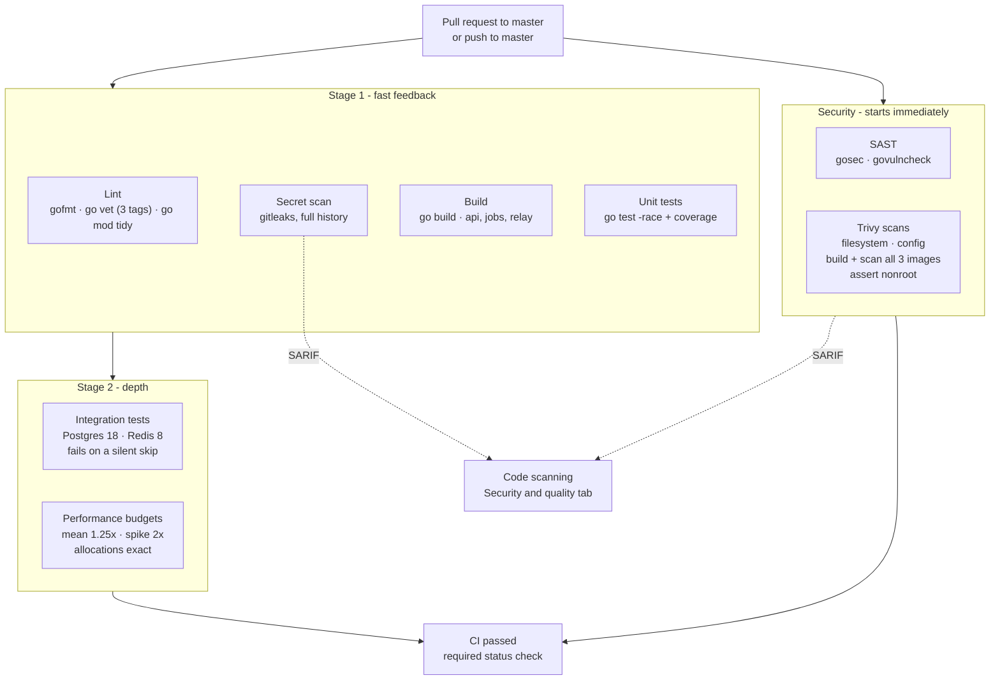

Set **`ci-passed`** as the required status check in branch protection rather than listing
each job, so adding a job later needs no rule change.

### Security results in code scanning

Every scanner uploads a SARIF report to GitHub code scanning through
`github/codeql-action/upload-sarif`, so findings appear under the repository's **Security
and quality** tab and as annotations on the pull request, not only in job logs. Each
upload has its own category:

| Category | Source |
|---|---|
| `gitleaks` | Secret scan over the full history |
| `gosec` | Static analysis |
| `govulncheck` | Go vulnerability database |
| `trivy-fs` | Dependencies, secrets and misconfigurations in the repository |
| `trivy-image-api`, `trivy-image-jobs`, `trivy-image-relay` | Each built image |

How the uploads are wired:

- **They run even when the scan fails** (`!cancelled()`), which is when the report matters
  most. An upload is skipped only when its scanner wrote no report.
- **govulncheck runs twice.** In SARIF mode it exits 0 even when it finds called
  vulnerabilities, so the SARIF run produces the report and a second, text-mode run is the
  gate. gosec and gitleaks gate and report in a single run.
- **Trivy reports use the gate's severity filter** (`TRIVY_SEVERITY`), so the tab shows what
  fails the build. Each Trivy gate runs even if an earlier one failed, so one failure does
  not hide the others.
- **Pull requests from forks skip the upload.** Their token cannot write security events;
  `CAN_UPLOAD_SARIF` limits uploads to pushes and same-repository pull requests. The scans
  still gate those runs.

Only the scanning jobs get `security-events: write`; the workflow default stays
`contents: read`. Alerts for `master` populate the tab once a run on `master` uploads;
pull-request results show on the pull request.

### Documentation-only changes skip the pipeline

Both triggers carry `paths-ignore`, so a change touching only these never starts a run:

```
**/*.md    Docs/**    LICENSE    .gitignore    .gitattributes
```

The filter is all-or-nothing: a push or PR that changes `README.md` *and* any Go file
runs the full pipeline. Only a change confined entirely to ignored paths is skipped.

**This interacts with branch protection.** GitHub reports a skipped workflow as *no
status* rather than success, so if `ci-passed` is a required check, a documentation-only
pull request waits forever on a check that will never run. Two ways out:

- Leave `ci-passed` unrequired and rely on the run that fires for code changes.
- Keep it required, drop `paths-ignore`, and instead gate the expensive jobs behind a
  cheap change-detection job so `ci-passed` still reports on every pull request.

The first is simpler; the second is what to reach for if merges must be blocked on a
green check without exception.

### Toolchain pinning

`GO_VERSION` in the workflow and `ARG GO_VERSION` in the `Dockerfile` are pinned to the
same patched Go release and are deliberately **not** read from `go.mod`. The `go`
directive there is a *minimum*, not a build version, so building with it ships every
standard-library CVE fixed since. Compiling the API image with the minimum produced 30
HIGH/CRITICAL findings against 14 on the patched release, the difference being entirely
standard library. Bump both together when a patch release lands.

Vulnerability advisories are published continuously, so a pipeline can turn red with no
code change: govulncheck and Trivy flag the new advisory on the next run. The fix is the
patched Go release in both pins and/or the patched module versions in `go.mod`.

### Two jobs that do not trust a green run

**Integration.** `testsupport` calls `t.Skip` when Postgres or Redis is unreachable —
correct locally, a false green in CI. The job fails on a skip message or on zero tests
executed, and reports the count it did run.

**Every step that pipes into `tee`** sets `set -o pipefail`. Without it the step takes
`tee`'s exit status, and a failing `go test` reports success — which is exactly what
happened on the first run: the integration package failed to compile and the job went
green.

### gosec exclusions

gosec runs with `-exclude=G115,G304,G404,G407`. Each was reviewed rather than suppressed
wholesale:

| Rule | Why excluded |
|---|---|
| `G407` hardcoded IV/nonce | False positive — the AES-GCM nonce is filled from `crypto/rand` immediately before use; the heuristic does not track the fill |
| `G404` weak RNG | Retry-backoff jitter, which has no security requirement |
| `G304` file inclusion via variable | Reads the CA bundle from an operator-supplied config path, which is the function's purpose |
| `G115` integer overflow | Conversions on bounded, non-attacker-controlled values (a 12-byte nonce length, operator-configured pool sizes, small shard indices) |

`G115` is the weakest of these: it is excluded repository-wide, so a genuinely
attacker-controlled narrowing conversion added later would not be caught.

### Performance budgets on shared runners

The baselines were measured on Apple Silicon; `ubuntu-latest` runs 2.1-2.4x slower on
pure-CPU paths and closer on AES-GCM, where hardware acceleration narrows the gap.
`PERF_SCALE` defaults to `2.5`, calibrated from that measurement — the worst observed
ratio was 2.40x, giving a minimum viable scale of `2.40 / 1.25 = 1.92`.

Allocation budgets are never scaled and hold on any hardware. They are the part of the
performance gate that is trustworthy in CI without calibration.

### Images

One `Dockerfile` builds all three services, selected by a build argument:

```bash
docker build --build-arg SERVICE=api -t payment-service/api:dev .
```

`golang-alpine` compiles a static `CGO_ENABLED=0 -trimpath` binary;
`gcr.io/distroless/static-debian12:nonroot` runs it. Images are 30-38 MB with no shell
and no package manager. SQL is compiled in via `go:embed`, so no `queries/` directory is
needed at runtime.

CD is intentionally absent until the infrastructure exists — the image job builds and
scans, but never pushes.
